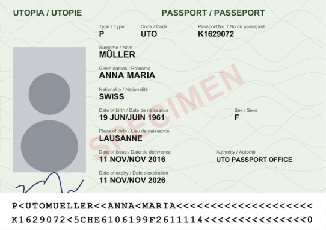
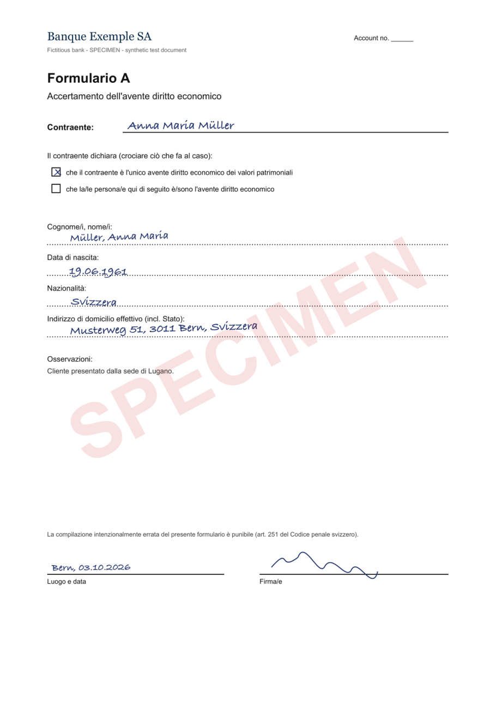
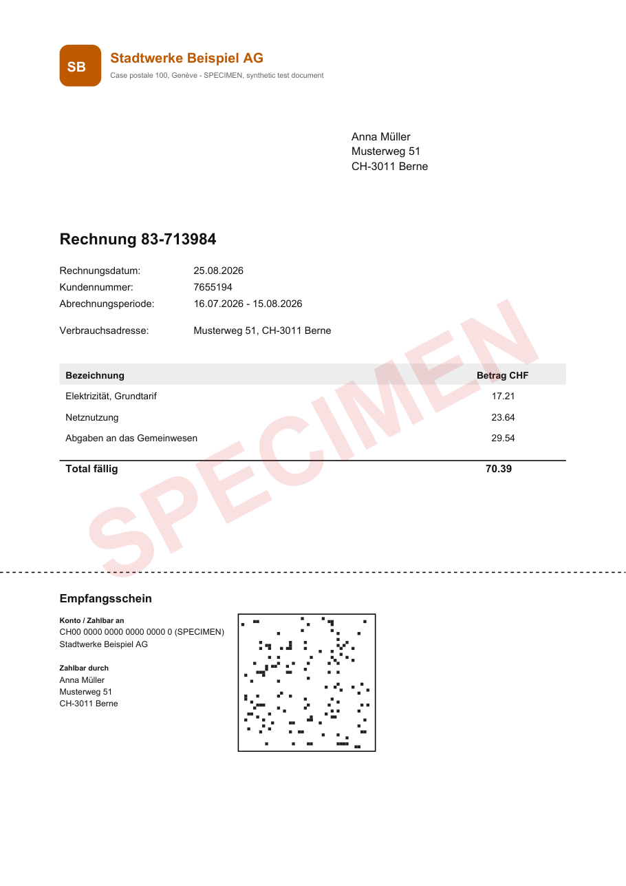
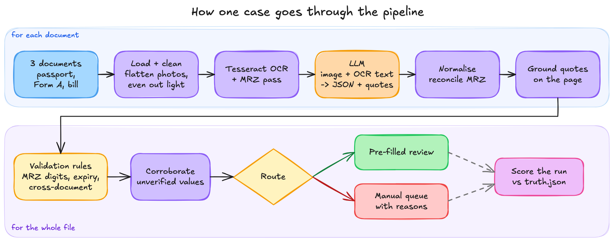

# KYC extractor (learning prototype)

I built this to learn how you'd actually use an LLM for KYC onboarding without trusting it blindly. You
give it a client's file (passport, Form A and proof of address, as clean PDFs, scans or phone photos) and
it pulls out the fields a compliance officer needs, checks them, and sends the file to the right review
queue. All the client data is synthetic, and every case comes with a `truth.json` (the correct values, the
problems I planted, and the flags a good run should raise), which is what I score each run against.

There's also a small web UI that replays a run step by step, so you can see what went into each stage,
what came out, and the code that ran.

How I went about it:

- First I needed data. I didn't want to use real client documents, so I wrote a generator
  (`kyc_demo/synth.py`) that makes up 30 fictional people and draws their paperwork with reportlab. The
  passports are issued by ICAO's specimen country "Utopia" and say SPECIMEN across the page, so nothing
  here could pass for a real document.
- Each person gets three files: a passport, a Form A and a utility bill as proof of address.
  - The passport is a proper TD3 data page with an MRZ.
  - The Form A is filled in by "hand" (a handwriting font), in English, French, German or Italian.
  - The bill looks like a normal Swiss bill, with an address window and a QR receipt.

  Here's `case_001` (clean tier). The bill says "Anna Müller" and "Berne" where the passport has "Anna
  Maria" and the form has "Bern", and the passport expires in three weeks. None of that should be flagged.

  <p>
    
    
    
  </p>

- Next to them sits a `truth.json` that says what the right values are, which problems I planted on
  purpose (an expired passport, a wrong MRZ check digit, a bill in someone else's name, a prompt injection
  hidden in the fine print, and so on) and which harmless differences should _not_ be flagged, like `Av.`
  for `Avenue` or a missing middle name.
- The same three documents are rendered again as a noisy grey scan and as a phone photo with shadows and
  blur, so the only thing that changes between them is image quality.
- Then I built a web UI to load these cases and watch them go through the pipeline. You pick a case, a
  quality level and a model, press Run, and each step shows up as it happens:
  - the pages are loaded, and photos get flattened and their lighting evened out
  - Tesseract OCR reads the text, with a separate pass just for the MRZ
  - the page image and the OCR text go to the model, which returns the fields as JSON with a quote for each
  - each quote is looked up on the page, so every value has a box you can point at
  - plain rules check everything against everything else (MRZ check digits, expiry, names and dates across
    the three documents, how old the bill is) and decide which review queue the file goes to

Here's the whole pipeline in one picture (the source is `docs/pipeline.excalidraw` if you want to open it
in Excalidraw and change it):



If you want to run it yourself:

```sh
python -m venv .venv && source .venv/bin/activate
pip install -r requirements.txt
brew install tesseract tesseract-lang      # OCR, with French/German/Italian
echo "OPENAI_API_KEY=sk-..." > .env        # optional, for the OpenAI models
ollama pull qwen2.5vl:7b                   # optional, to run everything locally

python -m kyc_demo generate                # makes the 30 cases in cases/{clean,scan,photo}/
python -m kyc_demo run cases/photo/case_016 -e openai:gpt-5.4-mini@both
python -m kyc_demo eval -e rules -e openai:gpt-5.4-mini@both --tiers photo

python -m kyc_demo serve                   # API on :8000
cd web && pnpm install && pnpm dev         # web UI on :5173
```

`-e` picks the model as `provider:model@input`, where input is `text` (OCR text only), `vision` (page
images only) or `both`. `rules` is the no-LLM baseline, and `ollama:qwen2.5vl:7b@both` keeps all the data
on your machine.

And here's a short demo video of it running:

[](https://youtu.be/LZuj11_8ink)
